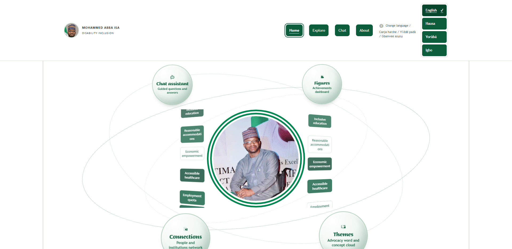
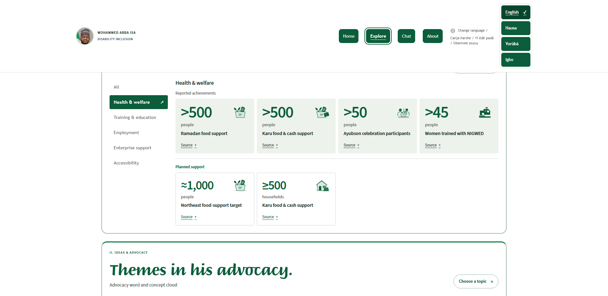
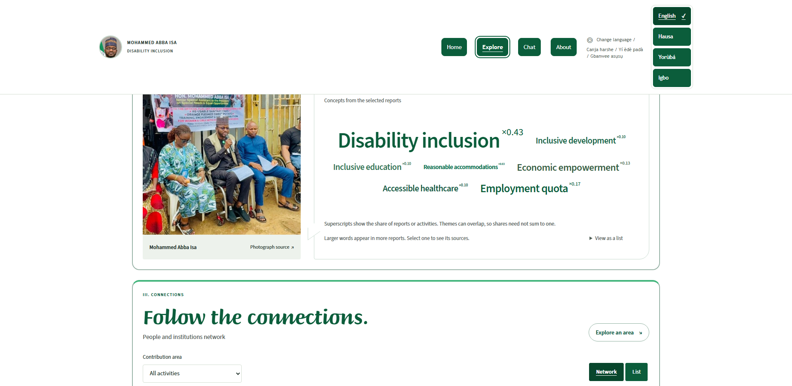
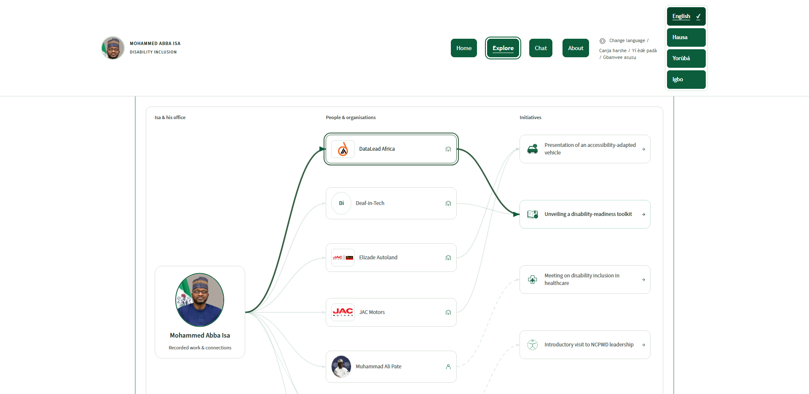
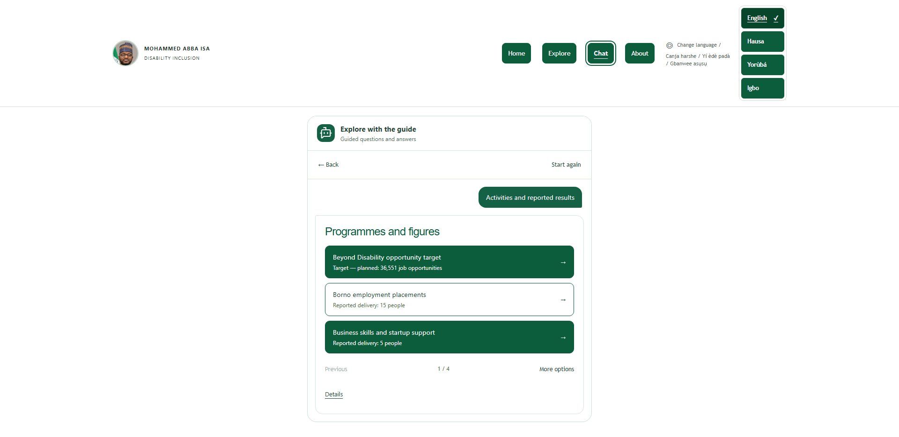
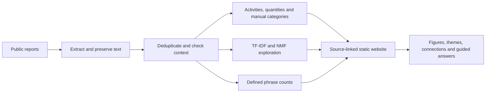

# Disability Inclusion Legacy Tree

## Mohammed Abba Isa - The Work in Numbers

An independent appreciation project that makes documented disability-inclusion work easier to explore through source-linked figures, advocacy themes, recorded connections and guided questions. The first tribute honours Hon. Mohammed Abba Isa; the wider purpose includes people and organisations supporting disability causes. This project does not imply official endorsement.

**[Visit the website](https://mohammed-abba-isa-legacy.pages.dev/)** · **[Illustrated PDF guide](docs/PROJECT_GUIDE.pdf)** · **[Source repository](https://github.com/batestguy/disability-inclusion-legacy-tree)**

**[Desktop video](https://github.com/batestguy/disability-inclusion-legacy-tree/releases/download/demo-2026-11-06/Hon-Mohammed-Abba-Isa-desktop.mp4)** · **[Mobile video](https://github.com/batestguy/disability-inclusion-legacy-tree/releases/download/demo-2026-11-06/Hon-Mohammed-Abba-Isa-mobile.mp4)**



**Status, 7 November 2026:** an owner-authorised, publicly accessible draft was published on free Cloudflare Pages on 6 November. English is the original language; Hausa, Yorùbá and Igbo remain visibly draft. Search indexing is discouraged with `noindex/nofollow`; this does not restrict visitor access. The repository name reflects the original tree prototype; the current interface uses portrait-led navigation and a contribution dashboard.

## Explore the tribute

| Destination | Description |
| --- | --- |
| [Home](https://mohammed-abba-isa-legacy.pages.dev/) | A genuine portrait, orbiting destinations and falling advocacy concepts introduce the tribute. Motion preferences provide a stationary alternative. |
| [Figures](https://mohammed-abba-isa-legacy.pages.dev/explore/?section=overview) | Browse contribution categories and programme-specific numbers. Reported achievements and planned support are separate; Source + reveals qualifications and citations. |
| [Themes](https://mohammed-abba-isa-legacy.pages.dev/explore/?section=advocacy) | Explore a concept cloud or list, switch between report concepts and activity themes, and select a phrase to inspect matching records. |
| [Connections](https://mohammed-abba-isa-legacy.pages.dev/explore/?section=collaborations) | Follow source-bound paths between Isa, people or institutions, and initiatives. Desktop uses three columns; mobile begins with a partner chooser. List and Show all connections remain available. |
| [Chat assistant](https://mohammed-abba-isa-legacy.pages.dev/chat/) | Choose prepared questions, read source-linked answers, follow related options, go back or restart. This is a deterministic question tree, not a live conversation with Isa or unrestricted generative chat. |
| [About](https://mohammed-abba-isa-legacy.pages.dev/about/) | Read the tribute context, biography, documentary photographs and creator profile/contact information. |
| [Methodology](https://mohammed-abba-isa-legacy.pages.dev/about/methodology/) | Read the short collection-to-interface explanation; technical settings sit behind a disclosure. |

### Figures with their meaning intact



The dashboard preserves numerical bounds, units, programme stages, attributed roles and limitations. A planned job-opportunity target is not jobs already delivered. People and households are different units. Overlapping cohorts and follow-up reports cannot be added into a unique-beneficiary total. Select **Source +** to inspect a figure's supporting record.

These are descriptive accounts of reported contributions, not independently audited delivery totals, causal estimates or an exhaustive lifetime record.

### Advocacy themes you can trace



Larger terms appear in more of the selected reports or activities. Superscripts show relative frequency to two decimals. Themes overlap, so shares need not sum to one. Selecting a term reveals matching records. Text frequency does not measure public opinion, programme success or causal impact. The displayed cloud uses defined phrase counts; its superscripts are not NMF topic weights.

### Connections grounded in records



Selecting a partner highlights its path and activities. On phones, choosing a partner first keeps the view manageable. A meeting, cooperation intention, signed agreement and reported programme are different claims; relationship labels and source context matter. Appearing in the same article alone does not establish a partnership.

### Guided questions in four languages



One shared control changes page and chat together, retaining supported record/conversation context. Options remain visible and vertically ordered **English / Hausa / Yorùbá / Igbo**, beneath **Change language / Canja harshe / Yí èdè padà / Gbanwee asụsụ**. The visitor assistant requires no paid inference service.

| Language | Home | Explore | Chat |
| --- | --- | --- | --- |
| English | [Home](https://mohammed-abba-isa-legacy.pages.dev/) | [Explore](https://mohammed-abba-isa-legacy.pages.dev/explore/) | [Chat](https://mohammed-abba-isa-legacy.pages.dev/chat/) |
| Hausa - draft | [Home](https://mohammed-abba-isa-legacy.pages.dev/ha/) | [Explore](https://mohammed-abba-isa-legacy.pages.dev/ha/explore/) | [Chat](https://mohammed-abba-isa-legacy.pages.dev/ha/chat/) |
| Yorùbá - draft | [Home](https://mohammed-abba-isa-legacy.pages.dev/yo/) | [Explore](https://mohammed-abba-isa-legacy.pages.dev/yo/explore/) | [Chat](https://mohammed-abba-isa-legacy.pages.dev/yo/chat/) |
| Igbo - draft | [Home](https://mohammed-abba-isa-legacy.pages.dev/ig/) | [Explore](https://mohammed-abba-isa-legacy.pages.dev/ig/explore/) | [Chat](https://mohammed-abba-isa-legacy.pages.dev/ig/chat/) |

Keyboard/focus support, reduced-motion behaviour, image fallbacks, enlarged-text checks and list alternatives are implemented. Automated accessibility checks do not establish complete accessibility certification or human language approval.

## Methods used and why we used them

The aim is a readable, traceable account of reported work on a free-tier stack. Each method has a specific job; none independently proves programme impact.

| Method | What it does here | Why we used it | Boundary |
| --- | --- | --- | --- |
| Python + WordPress REST API | Downloads public office reports and preserves source URLs and metadata. | Makes collection repeatable and keeps claims traceable to their origin. | Office reporting is not independent corroboration; coverage is incomplete. |
| Beautiful Soup text extraction | Removes HTML markup while retaining article text for review/analysis. | Separates readable content from webpage structure. | Clean text still needs context checks. |
| Exact-text deduplication and canonical aliases | Maps repeated documents to one canonical text while retaining references. | Prevents exact copies inflating text counts and preserves provenance. | Similar events and overlapping cohorts also need manual checks. |
| Source-context and quantity review | Preserves units, bounds, dates, attributed roles and planned/reported stages. | Prevents misleading totals and plans being shown as delivery. | Review is against reports, not an independent audit. |
| TF-IDF in scikit-learn | Weights distinctive words/phrases across selected English reports. | Reduces the dominance of common terms and creates inspectable features for topic exploration. | Weights describe text, not importance to beneficiaries. |
| Non-negative matrix factorisation (NMF) | Groups recurring weighted terms into eight descriptive topics in the selected v1 fit. | Produces additive term groups that can be inspected alongside their reports. | Topics are exploratory patterns, not verified categories, sentiment or causal effects. |
| Manual multilabel categories | Assigns activity categories by reading the reports. | Keeps filters grounded in activity meaning; one activity can span several areas. | Category counts can overlap and differ from model topics. |
| Defined phrase counts and relative frequency | Counts each phrase once per canonical report; activity mode counts matching activities. | Makes cloud size and superscripts explainable and source-reproducible. | Shares can overlap; the cloud is not an NMF-weight visualisation. |
| Source-bound relationship mapping | Connects named actors, initiatives and their documented roles. | Makes collaboration context discoverable while preserving the kind of relationship reported. | Co-occurrence alone is not partnership or attribution of sole credit. |
| Deterministic guided question tree | Presents prepared answers, related choices and source actions. | Keeps answers predictable, reviewable and usable without paid runtime inference. | Does not promise free-text understanding or impersonate Isa. |
| Static export + free Cloudflare Pages | Serves prebuilt pages and committed public content. | Keeps hosting simple and free, without a runtime model server. | Static output does not guarantee full offline reload support. |
| AI coding-agent assistance | Supports scripts, interface work, draft translations and automated checks under owner feedback. | Helps implement and iterate across the research and app workflow. | Agent output is not evidence, linguistic approval or permission certification. |



The selected frozen v1 model uses **30 distinct texts and eight topics**; the wider archive's exploratory model is separate. The frozen research bundle and later presentation additions have different scopes. Read the [v1 findings](docs/PHASE2_FINDINGS.md), [dashboard data directory](content/dashboard/) and [metric definitions](docs/CONTRIBUTION_METRICS.md) before quoting inventory counts. Original source quotations retain their source language.

Implementation: [collection](scripts/collect-office-evidence.py), [analysis](scripts/prepare-analysis.py), [bundle preparation](scripts/build-dashboard-bundle.py), [phrase counts](scripts/extract-dashboard-concepts.mjs), [presentation/relationships](apps/web/lib/dashboard-presentation.mjs), [guided flow](apps/web/lib/guided-flow.mjs).

## Video walkthroughs and illustrated PDF

**[Download/read the eight-page illustrated project guide](docs/PROJECT_GUIDE.pdf).** It includes real site screenshots, visual descriptions, methods and their rationale, a workflow diagram, clickable destinations and current release limits. [Screenshot provenance](docs/images/README.md).

Both videos are **3:16** with 40 English caption cues, music and no narration: six-second tribute introduction, the original walkthrough, 40 seconds on methods, and a ten-second author ending.

| Video | Link | Format |
| --- | --- | --- |
| Desktop walkthrough | [Watch/download desktop MP4](https://github.com/batestguy/disability-inclusion-legacy-tree/releases/download/demo-2026-11-06/Hon-Mohammed-Abba-Isa-desktop.mp4) | 1920 × 1080, H.264/AAC, 30fps |
| Mobile walkthrough | [Watch/download mobile MP4](https://github.com/batestguy/disability-inclusion-legacy-tree/releases/download/demo-2026-11-06/Hon-Mohammed-Abba-Isa-mobile.mp4) | 1080 × 1920, H.264/AAC, 30fps |
| Local review player | [Open review player](http://127.0.0.1:8770/) after running `node scripts/serve-demo.mjs` | Switch layouts, download and jump to methods |

**Public video links:** the MP4s are hosted as assets on the [demo release](https://github.com/batestguy/disability-inclusion-legacy-tree/releases/tag/demo-2026-11-06). Depending on the browser they may play or download. The [illustrated PDF is also available as a release download](https://github.com/batestguy/disability-inclusion-legacy-tree/releases/download/demo-2026-11-06/Mohammed-Abba-Isa-Project-Guide.pdf). Originals, raw takes and the supplied soundtrack remain local/ignored in the Git checkout. The owner confirmed permission to publish the music on 7 November; this is not a downstream music reuse licence. See the [video publication record](docs/VIDEO_PUBLICATION_2026-11-07.md).

See the [storyboard and reproduction steps](docs/DEMO_STORYBOARD.md) and [delivery manifest](docs/DEMO_DELIVERY.json) for timing, dimensions, hashes and verification. The method segment is 2:18-2:58; the author ending is 3:06-3:16.

## Run locally

Requires Node 22.12+ and npm 11; the recorded environment used Node 24.15. On Windows use `npm.cmd`; elsewhere use `npm` for the same scripts.

```powershell
git clone https://github.com/batestguy/disability-inclusion-legacy-tree.git
cd disability-inclusion-legacy-tree
npm.cmd ci
npm.cmd run preflight
npm.cmd run dev       # http://127.0.0.1:3000
```

In separate terminals, `npm.cmd run studio` opens the standalone Sanity editor on port 3333. After building, `npm.cmd run preview` serves the static site at `http://127.0.0.1:8767/`.

```powershell
npm.cmd run lint
npm.cmd run typecheck
npm.cmd test
npm.cmd run build     # apps/web/out and studio/dist
```

Browser checks require Playwright Chromium. See [validation commands and evidence](docs/VALIDATION.md). To regenerate the PDF in a Python environment with ReportLab, PyMuPDF and Pillow, run `python scripts/build-project-guide.py`; these are documentation tools, not website production dependencies.

## Architecture and configuration

| Area | Location / implementation |
| --- | --- |
| Public app | `apps/web`: Next.js static export, React, TypeScript, Tailwind, Radix UI and GSAP |
| Content | `content/`: source-linked records, dashboard bundles, locale drafts and asset manifests |
| Research/tools | `research/` and `scripts/`: review records, collection, analysis, exports and verification |
| Guided answers | `apps/web/lib`: deterministic flows, evidence validation and shared locale/context logic |
| Optional editor | `studio/`: standalone Sanity Studio; the hosted release has no connected live dataset |
| Hosting | Free Cloudflare Pages direct upload; GitHub pushes do not deploy automatically |

Copy `.env.example` to `apps/web/.env.local` if public configuration is needed. It contains public Sanity IDs, `SITE_URL`, `RELEASE_MODE` and an optional public GoatCounter account name. Never store credentials in the repository or public bundle. With no Sanity configuration, the app uses committed content. Analytics is optional and unconfigured for this release. See [CMS](docs/CMS.md) and [operations](docs/OPERATIONS.md).

## Release status, validation and reuse

The [6 November publication record](docs/PUBLICATION_2026-11-06.md) records the owner's permission to publish the displayed photos/logos, release scope and live verification. This is an owner attestation, not independent licence verification or a blanket grant for future assets. Preview mode, translation-draft labels and the stricter `RELEASE_MODE=public` gates remain.

Recorded application validation on 6 November includes preflight, lint, typecheck, 76 tests, four-language coverage and web/Studio builds. Live landing/mobile-network checks recorded zero axe violations across 13 tested states. [VALIDATION.md](docs/VALIDATION.md) gives dates, conditions and limitations. Human language review, remaining human accessibility checks and fresh performance evidence must be recorded honestly. Full offline reload support and proposed advanced conversational features are not claimed.

No blanket open-source licence has been granted for application code or third-party photographs. The earlier adapted baobab artwork has a separate [CC BY-SA 4.0 notice](docs/TREE_ART.md). A public repository grants no additional photograph, logo, music or source-material reuse rights.

## Creator and project records

Created by **Jerry Zachary Bannister**, statistician, data scientist and researcher in Statistics at Abubakar Tafawa Balewa University, Bauchi, and the creator of JJMB Datascience Hub. His work applies statistics, machine learning and AI to local problems, with a vision of accessible, affordable tools shaped by disabled people's needs and choices. This project uses TF-IDF and NMF for descriptive exploration of selected reports. [Creator profile/contact](https://mohammed-abba-isa-legacy.pages.dev/about/) · [GitHub profile](https://github.com/batestguy).

| Record | Purpose |
| --- | --- |
| [Handoff](HANDOFF.md) | Latest continuation status and delivery |
| [Project plan](PROJECT_PLAN.md) | Decisions, historical phases and release gates |
| [Original brief](HonAbbas.txt) | Preserved owner brief |
| [Chat specification](docs/CHATBOT_SPEC.md) | Guided behaviour and shared language contract |
| [Source collection](docs/SOURCE_COLLECTION.md) | Collection coverage, storage and reproducible procedure |
| [Research findings](docs/PHASE2_FINDINGS.md) | Selected v1 model and quantity reconciliation |
| [Publication record](docs/PUBLICATION_2026-11-06.md) | Hosting, permission attestation and live verification |
| [Operations](docs/OPERATIONS.md) | Publishing, backup and rollback |

For corrections, use the creator contact on About and identify the activity, figure or source concerned. Preserve source links, numeric qualifications, draft labels and permission records when proposing changes. Consult the latest handoff before relying on historical design documents.
