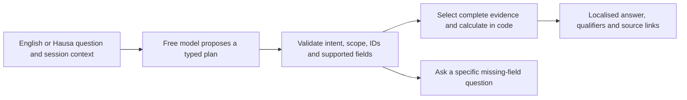

# Modernising the chatbot within free tiers

Research checked 25 October 2026. Recommendation for an experiment, not a deployed
service, provider-quality result or promise of free unlimited availability. User
constraint: **free tier**, without automatic billing, paid fallback or trial-credit
assumptions. Read the [baseline audit](CHATBOT_ACCURACY_AUDIT.md) and
[provider findings](FREE_TIER_PROVIDER_FINDINGS.md).

## Recommendation

Replace the phrase-matching front end with a **model-assisted semantic planner**,
connected to complete reviewed fact cards and deterministic operations. Keep the
existing source/claim checks and bilingual interface. Start by benchmarking
**Groq Free, `openai/gpt-oss-120b`**, against its smaller 20B option, behind a
**Cloudflare Workers Free** endpoint. Benchmark a free-eligible Workers AI model
as a second provider if useful. This is an architectural recommendation: no model
has yet demonstrated adequate Hausa understanding on this project's unseen test.

Groq documents constrained JSON-schema output for these candidates. That supports
turning natural questions into explicit operations, rather than matching the
wording of every question. It guarantees a supported output shape, not correct
intent, source selection or truth. The application must independently validate
what the plan means. Strict output currently cannot be combined with streaming
or tool use; request one non-streaming plan and execute it in our code.
[Groq structured outputs](https://console.groq.com/docs/structured-outputs),
[Google's semantic-validation warning](https://ai.google.dev/gemini-api/docs/structured-output).

The audit's main issue is ordinary language understanding, not demonstrated
arithmetic failure. Patching fifty more literal phrases will leave this problem
in place. A model can interpret “the year of that report”, Hausa paraphrases,
typos, code-switching and multipart questions; whether a particular free endpoint
does so reliably must be measured. Extend answer coverage to **all 11 reviewed
observations and all 33 activities**, including attribution, meetings, sources,
themes and methods. A better parser alone cannot expose facts that the executor
does not yet support.

## How the proposed response path works

1. **Prepare contextual fact cards locally.** One card per activity; one per
   observation where needed; compact cards for categories, topics, relationships
   and methodology. Retain original IDs, source excerpts and provenance. Fields
   should include report/event date basis, bound, unit, population, stage, actors,
   role, partners and limitations. Population-specific evidence must remain bound
   to its source, rather than inferred from a general cohort.
2. **Interpret the whole question.** Give the planner the original question,
   explicit page locale, recent structured context and a compact catalogue of
   allowed operations and record IDs. Return a schema-constrained plan with
   intent, requested field, supported filters, entity/measure IDs, date basis and
   missing slots. Do not allow arbitrary SQL, code or invented record IDs.
   A model confidence number is not an accuracy probability.
3. **Validate meaning before execution.** “Year” must select report year, “how
   many people” must not select household targets, and support recipients must
   not become people with measured income gains. Validate attributions and
   population/source bindings. Do not use isolated words such as “impact” or
   “money” to refuse an otherwise answerable question. For a multipart question,
   allow at most two bounded subplans rather than an autonomous agent loop.
4. **Execute approved operations over the complete relevant dataset.** Count
   distinct activities with the declared filters, not just retrieved snippets.
   Expose every reviewed numerical observation through its own metric contract;
   never sum unlike or potentially overlapping people counts. Keep targets and
   delivery separate, preserve strict bounds and handle missing quantities.
5. **Render a conversational answer from verified facts.** Use natural bilingual
   sentence fragments and curated explanatory cards, with selected source links.
   Initially the model selects the plan, not new numerical prose. This preserves
   the current claim safeguards without making visitors use fixed phrases.
   An optional later narrative model is a separate experiment requiring full
   attribution/qualifier validation; checking digit strings alone is insufficient.
6. **Clarify the actual missing slot.** Ask “Which programme?” or “Do you mean
   report year or event date?” when needed. A generic suggestion list is not
   useful clarification. Unavailable evidence should receive a specific limitation.

Example: “What has he done for disabled women?” selects the women-with-disabilities
population and supported activities, then retrieves the two source-specific
cohorts. The answer keeps >45 NigWED trainees and >20 startup-support recipients
separate, with office/partner attribution and unknown overlap. “And the year of
that report?” after a single programme selects a date field; after two activities,
it asks which activity is intended.

## Retrieval: modern methods without unnecessary infrastructure

The current bundle is small. A local measurement of a compact catalogue containing
33 IDs/titles/categories/report dates/source IDs and all 11 measure descriptors
was **10,964 characters / 10,966 UTF-8 bytes**. This is not a token estimate and
does not include the full prompt or all qualitative actor facts. Measure actual
provider token usage before setting budgets.

For the first experiment, compare giving the planner this whole compact catalogue
against retrieving candidate cards. A paid vector database is unnecessary for
33 records. Plain arrays and local similarity scores suffice. A title catalogue
alone is not the complete knowledge base: actor attribution, source variation and
method facts need their own reviewed fields/cards.

When retrieval becomes necessary, combine lexical BM25 with multilingual dense
embeddings, merge rankings, and evaluate an optional reranker. Preserve programme,
population and date context with each card. BM25 protects exact names and source
IDs; dense search can recover paraphrases. Anthropic's contextual-retrieval work
and BGE-M3's publisher recommend these complementary retrieval approaches; their
published gains are not predictions for this chatbot.
[Contextual retrieval](https://www.anthropic.com/research/contextual-retrieval),
[BGE-M3 model card](https://huggingface.co/BAAI/bge-m3).

Precompute document embeddings on this machine with an appropriately licensed
open model. Runtime query embedding still needs compute: offline document vectors
alone do not provide semantic query search. Options are a suitable local/browser
encoder or a free inference endpoint. Benchmark the added download, latency and
quota cost. Workers AI currently lists BGE-M3, but invoking it shares the AI
allowance; do not call it a separate unlimited free service.
[Workers AI pricing](https://developers.cloudflare.com/workers-ai/platform/pricing/).

Do not let retrieval truncate a global count: topical retrieval and complete-set
arithmetic serve different purposes. Do not start with GraphRAG, an agent swarm,
fine-tuning or a large orchestration dependency. The dataset and observed failures
do not currently justify their operational or evaluation cost. This is a
project-specific engineering judgement, not a universal rejection of those methods.

## Free-tier deployment comparison

| Option | Fit for this project | Material boundary |
| --- | --- | --- |
| Groq Free + Workers Free | First planner experiment; strict schema available; static site stays static | Shared request/token limits; Hausa understanding unmeasured; external processing |
| Workers AI on Workers Free | Alternative single-provider experiment | Daily neurons are model-dependent; some models require billing; per-model schema behaviour must be tested |
| Gemini API Free | Strong structured-output candidate for an eligible controlled pilot | Current unpaid-data and audience restrictions complicate an unrestricted public site |
| Browser/local open model | Privacy/offline research alternative | Hardware, download size, language quality and licensing; not a free managed hosting SLA |

Groq's published default table for the selected models lists 1,000 requests/day
and 200,000 tokens/day, with an 8,000-token/minute ceiling; organization limits can
differ. The token budget can bind much earlier than the request count. Illustrative
arithmetic: a 2,000-token total per turn permits at most 100 turns/day from a
200,000-token allowance; 4,000 permits 50. This is not measured capacity and must
include context, output/reasoning tokens, retries and other organization traffic.
Design for one short model call per turn and no automatic paid fallback.
[Groq limits](https://console.groq.com/docs/rate-limits).

Workers Free currently provides 100,000 requests/day and 10 ms CPU/request. That
is endpoint hosting, distinct from AI inference. Network waiting does not consume
CPU, but parsing, validation, hashing and retrieval do. Benchmark the small
endpoint instead of assuming the whole application can move to a free dynamic
server unchanged. Keep keys in deployment secrets, outside the repository and
browser. [Workers limits](https://developers.cloudflare.com/workers/platform/limits/).

Workers AI provides 10,000 neurons/day; exhaustion on Free fails requests rather
than providing unlimited inference. Its free-eligible catalogue includes GLM 4.7
Flash and Gemma 4 26B A4B according to the official free-model update. Some newer
models are paid-only. Function calling or a generic `response_format` parameter
does not establish strict schema support: the model catalogue and JSON-mode
documentation must be checked together, then tested.
[AI pricing](https://developers.cloudflare.com/workers-ai/platform/pricing/),
[free-model update](https://developers.cloudflare.com/changelog/post/2026-07-28-models-require-workers-paid/),
[JSON mode](https://developers.cloudflare.com/workers-ai/features/json-mode/).

Gemini Free is not the default public recommendation here. Its current additional
terms restrict clients likely accessed by under-18s, require paid services for
clients offered in the EEA/UK/Switzerland, and permit unpaid inputs/outputs to be
used for product improvement and human review. Operator eligibility in Nigeria
does not by itself resolve public-audience restrictions. This is a provider-fit
inference from the terms, not a recommendation to upgrade or add an age gate.
[Gemini terms](https://ai.google.dev/gemini-api/terms).

Preserve session-local chat state and avoid raw-query application logs. Groq
documents default inference non-retention with exceptions and configurable data
controls. Workers AI documents no training on Customer Content and limited
stateless processing, with stateful/logging exceptions. Routing a request through
Cloudflare does not transfer those Workers AI commitments to Groq or Google.
Provider account settings and actual geographic/account availability remain
unverified; no account or credential was inspected.
[Groq data handling](https://console.groq.com/docs/your-data),
[Workers AI data handling](https://developers.cloudflare.com/workers-ai/platform/data-usage/).

Groq's current services agreement permits customer-application integration and
puts end-user notices/consents and applicable minor-user obligations on the
customer. Its operator age requirement is not a certification of this site's
audience design. Actual integration still needs those checks.
[Groq services agreement](https://console.groq.com/docs/legal/services-agreement).

Enabling an external planner also requires changing the current local-only privacy
notice and implementing cancellation/invalidation of in-flight requests on locale,
context or dataset changes. Preserve the pending question and re-render verified
claims in the active page language. Research does not itself approve this change
to the existing no-external-inference architecture.

## Hausa and offline operation are separate acceptance requirements

“Multilingual” is not sufficient evidence of Hausa capability. A 2025 Hausa/Igbo/
Yoruba retrieval paper shows that adaptation can improve BGE-M3 on the authors'
benchmarks, but those retrieval scores are not chatbot answer accuracy. Use that
finding as a reason to evaluate low-resource languages separately, not as grounds
to promise this site's future score.
[Hausa retrieval research](https://aclanthology.org/2025.winlp-main.33/).

Test original Hausa, natural synonyms, typos, code-switching and follow-ups. Never
silently change the user's chosen page/chat locale. Route to language-neutral
plans; render verified English/Hausa templates, with fluent-human review before
reveal. If query translation is evaluated, preserve its original text and test
whether translation changes counts, negation, populations or dates.

Tiny Aya Earth is a relevant local research candidate because its publisher
explicitly lists Hausa and regional language focus. It is 3.35B parameters with
a non-commercial research licence; free weights are not a blanket production-use
permission or free hosted API. NLLB also has non-commercial limitations. These
are not drop-in production defaults. WebLLM can run models in a browser, but
requires compatible WebGPU hardware; it cannot be mandatory for visitors without
testing their device/download constraints.
[Tiny Aya Earth](https://huggingface.co/CohereLabs/tiny-aya-earth),
[NLLB](https://huggingface.co/facebook/nllb-200-distilled-600M),
[WebLLM requirements](https://webllm.mlc.ai/docs/user/get_started.html).

The accepted product direction requires offline use after a completed first visit.
A hosted language model cannot provide equal offline conversation by itself.
Provide a genuinely useful offline path with cached evidence, complete local
metrics, bilingual search and guided questions; distinguish its capability from
online semantic planning. Equal-quality free-form offline conversation would
require a separately benchmarked local model. Do not silently claim parity or
change the accepted offline contract while implementing an online enhancement.

## Concrete experiment and acceptance plan

1. Preserve the frozen audit and current engine hash. Write a provider-neutral
   plan schema and explicit missing-information responses. Complete fact cards
   and deterministic operations for every reviewed record/measure.
2. Build an isolated planner adapter and mock provider; no deployment or account
   connection until implementation is requested. Start with one strict-schema
   candidate. Set token/time/call caps and quota exhaustion behaviour.
3. Use a development set broader than the exposed fifty, including natural
   institution/place queries, attribution, targets, overlap, ambiguous counts,
   comparative requests and multipart methodological questions. Keep adversarial
   record/context tests and test cited IDs, not digit matching alone.
4. Author a new independent **100-question held-out set**, 50 per language, before
   viewing model results. Evaluate correct plan/scope selection, factual and
   citation correctness, complete answer usefulness, excessive refusal, targeted
   clarification and language quality separately. Score partial answers honestly.
5. Proposed diagnostic targets: at least 90% complete supported-answer success
   in each language, at least 95% correct evidence/plan selection, no wrong
   numerical/bound/stage/population/attribution answers, and meaningful limitations
   or targeted questions for at least 90% of genuinely unanswerable/ambiguous cases.
   These are unachieved targets, not new owner-approved release gates. Zero
   observed errors is not proof that future errors are impossible.
6. Measure token consumption and p50/p95 end-to-end latency on real free accounts,
   including Nigerian-network conditions. Test transient 429s, exhausted quota,
   missing credentials, unavailable network and low-memory/mobile conditions.
   Never bypass free quotas by rotating accounts/keys.
7. Only choose a provider after the held-out English/Hausa evaluation, cost-budget
   check and privacy/offline decisions. If both model candidates fail, retain
   guided evidence access and improve the design; do not relabel failures as safety.

This research recommends a promising architecture, not a measured improvement.
No provider inference, fine-tuning, dependency installation, billing change,
deployment or chatbot/baseline modification was performed. Existing portrait,
source review, human Hausa and public-reveal gates remain unchanged.
